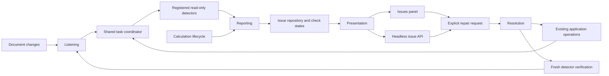

# Issue reporting in 0.1.6

Open **Issues** below the viewport, or use **View → Issues panel**. Filter by text
or severity, select a finding to inspect its evidence, and use **Select target**,
**Frame target**, or a related-object button to navigate. Navigation does not
change workspace membership or editability. It is disabled during an active edit.

**Recheck** runs available detectors; it does not repair geometry. **Dismiss** hides
one finding at its current source revision. Enable **Dismissed** to restore it.
Changed source evidence receives a new identity and is shown again. Dismissal does
not make the document clean. Findings and dismissals are session diagnostics, not
authored anatomy or persistent project appearance.

The panel distinguishes check completion from issue severity and output freshness.
An empty list with pending, failed or cancelled checks does not establish that the
document is clean. “No findings in available checks” covers only registered checks;
it does not certify anatomical correctness, mesh quality or collision clearance.

## Source architecture and migration

The addon was inspected in the local checkout at `fae36aba1b208676cf21d7c4a78a20d5b1f68c66`.
The reference root is
`C:/Users/alexe/AppData/Roaming/Blender Foundation/Blender/5.0/scripts/addons/anthroforge`.
These are responsibility/contract adaptations of AnthroForge code, under the
repository's GPL-3.0-or-later license, without a Blender runtime dependency.

| Addon component | Responsibility | Standalone owner |
| --- | --- | --- |
| `core/issues/model.py`, `repository.py` | Immutable evidence, identities, provider/scope reconciliation, check coverage | `core/issues.py`, `application/issues/repository.py` |
| `core/issues/reporting.py` | Direct reports, generation/epoch guarded check completion, retained stale evidence | `application/issues/reporting.py` |
| `core/issues/listening.py`, `coordinator.py` | Registered detectors, change discovery, debouncing, cancellation | `application/issues/listening.py`, `checking.py`, existing `TaskCoordinator` and dedicated `IssueTaskScheduler` |
| `core/issues/presentation.py`, `core/warnings/query.py` | Read-only filtering, serialization, dismissal and target navigation | `application/issues/presentation.py`, shared `issues.*` commands, desktop adapter |
| `core/issues/resolution.py` | Explicit registered solvers, applicability, cancellation, verification | `application/issues/resolution.py`, `repairs.py` |
| `core/issues/system.py`, `core/warnings/session.py` | Composition and lifecycle | Per-Session `IssueSystem`; no global singleton |
| `adapters/mesh_issues.py`, `issue_registration.py`, `issue_recheck.py`; `core/visualization/warning_*` | Domain detection, native worker capture/publication and registered repairs | Current-state providers and task lifecycle adapter; future geometry detectors use owned native batches |
| `ui/warnings.py`, `ui/issue_actions.py` | Display, filters, selection and explicit actions | `IssuePanel`, `Issues.qml`, `IssueDetails.qml`, incremental `RecordModel` |

Reporting, presentation and detection never invoke repair. Providers cannot clear
another provider's findings. A failure retains prior evidence as stale. Deleted
scopes are retired; project replacement and undo/redo reset check epochs so late
results cannot overwrite the new state. Repair completion is reported as `DONE`
only after a new successful check no longer finds the same problem. An ineffective
action is `UNRESOLVED`; failure/cancellation remain distinct. Cancelling a repair
requests safe cancellation of its submitted jobs; it does not undo accepted results.

## Current providers and boundaries

- `evaluation.v1`: failed SCP/control evaluation, pending output, accepted output
  with pending upstream changes, and attachments lacking an accepted support surface.
- `dependencies.v1`: blocked pose/control/cage/geometry outputs from the existing
  dependency graph, with direct input identities. A blocked output may be in a cycle
  or downstream of one; this release does not claim an exact cycle path.
- `tasks.v1`: calculation failures, including import/file failures without an SCP
  target. Successful retries retire the matching failure. Activity retains job history.

Available repairs reuse **Recalculate target** and **Retry calculation**. No repair
silently detaches controls, changes attachment modes, breaks cycles, or changes
geometry parameters. Shared workspace and active-edit restrictions apply.

The addon's fiber-anchor collision checks and skin/topology mesh-quality checks
depend on systems not yet present in the standalone application. Their detectors
and repair solvers are not falsely advertised as migrated. The framework has the
registration ports needed when those features arrive. The wider attachment inspector,
workspace manager, units, and inspection-package recommendations remain separate work.

## Scheduling, persistence and performance

Checks share the application worker pool and coordinator. They receive immutable
dispatch-time inputs, validate producer generations and source inputs before adoption,
and never reserve geometry outputs. They are read-only jobs: no document revision,
undo entry, commitment barrier, or save wait is created by a diagnostic check.
`wait` still waits for all jobs when explicitly requested; saving with `wait` drains
only document writers and their queued dependent work.

Automatic checks are deferred while a drag transaction is active; existing findings
become stale. Changes are coalesced per provider, with a dedicated complexity policy
and lower priority than geometry work. One failed scope/provider does not stop the
other detectors. Cancellation and unknown coverage are visible rather than “clean”.

The Issues and Activity adapters share stable keyed Qt rows. Geometry drags do not
rebuild an unchanged issue list; repository and label revisions gate projection.
There is no detection or solver work in QML drawing, list filtering, or serialization.
No numerical geometry algorithm was added in Python: current detectors inspect
existing domain state and native evaluation outcomes. Future geometric checks must
retain the repository's batched C++ boundary.

Source checks: `pytest tests/test_issue_reporting.py tests/test_issue_integration.py
tests/test_issue_lifecycle.py`, `tools/issues_acceptance.py`, and
`tools/issues_profile_acceptance.py`. GUI/profile artifacts are ignored local output
under `build/issues-016`; release evidence is recorded in the task handoff.

Qt model notifications follow the [official model/view contracts](https://doc.qt.io/qt-6/model-view-programming.html).
