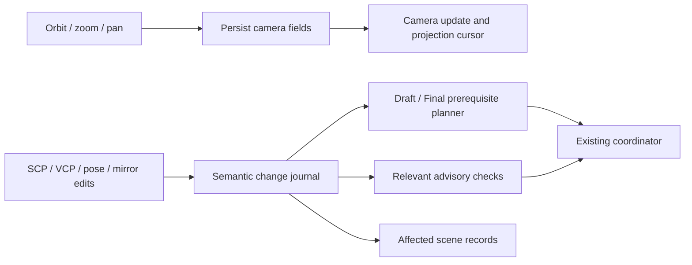
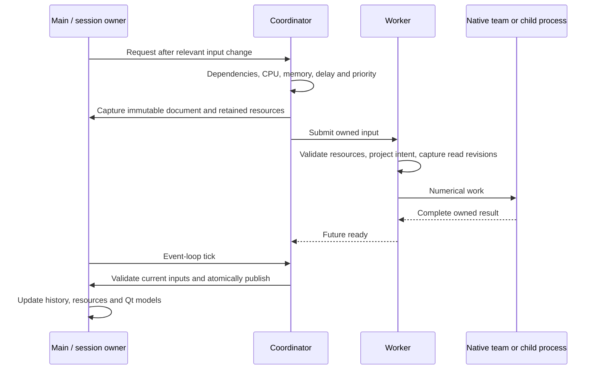
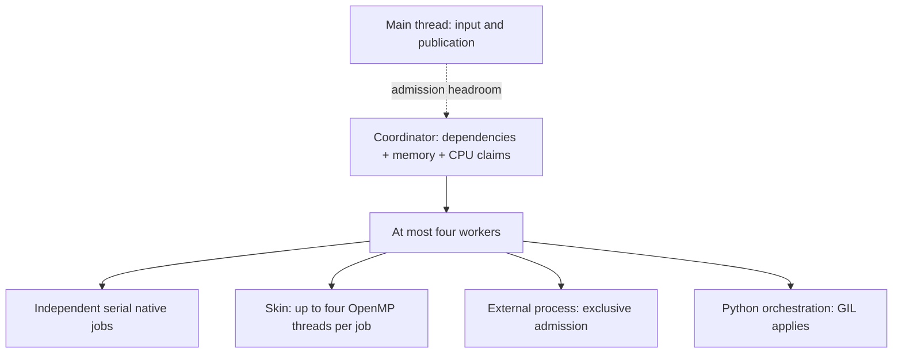

# Viewport, worker ownership and CPU audit

2026-11-27; baseline `60b64ec4`. Qualification: [task record](tasks/viewport-worker-responsiveness.md).

## Cause and implemented changes

Camera persistence changed `workspaces`. Mirroring treated every workspace change as
relevant, scene caches included the entire workspace, and the skin panel calculated readiness
before its unchanged-context guard. Suppressing only mirror checks therefore left substantial lag.

`ChangeJournal` now records workspace fields. Mirroring uses immutable anatomical inputs;
camera/orthographic changes cannot request a check. Its publication stamp also includes actual
entity/control/object inputs, preventing late evidence from surviving a pose change just because
mirror rules stayed the same. `external_references` is now journaled, matching the assembly
provider's existing dependency declaration.

Scene projection consumes camera-only deltas without rebuilding render rows. Scene cache keys
omit camera/orthographic fields. Shared skin readiness is cached by domain inputs and builder
configuration; camera saves neither invalidate it nor dirty the planner. Visibility/membership,
model edits, mirror rules and builder changes still invalidate their respective outputs.
Camera persistence, save revisions, undo and Draft/Final contracts are preserved.

## Thread ownership

Jobs already computed on workers; capture and publication ran on the session owner, which is
the desktop main thread. A background label never guaranteed an entirely off-thread lifecycle.

Independent preparation now runs on the existing worker: inspection resource selection and
validation, advisory-check source preparation, painting and tissue-query preparation, skin
intent projection, and captured read-revision assembly for construction, deformation and fitting.
Owner-thread capture retains immutable documents and copies resource catalogues. Native allocations
remain retained independently of subsequent live-catalogue changes. Workers receive the engine
and owned values, not permission to mutate Session or Qt objects.

Desktop completion has a shared 2 ms admission window across editing contexts. One result is
always allowed to complete atomically; the window defers later results rather than interrupting
a result after 2 ms. Context order rotates to prevent starvation. Shutdown cancels workers,
joins them and drains cleanup without this UI budget. Headless callers retain unbounded draining.
A large individual publication can still exceed 2 ms.

## Registered jobs and triggers

There are 47 registered kinds: 46 concrete kinds plus the generic extension policy. All have
worker execution except the four marked **conditional inline**: small interactive requests can
use the existing measured 2 ms inline budget. Dependency, coalescing, priority, read-revision
and exclusive-output guards govern every dispatch.

| Kinds | When and why requested |
|---|---|
| `attachments`, `anchor_binding` — conditional inline | Relevant parent/child pose, surface or binding edits; update attachment frames. |
| `control_pose` — conditional inline | Control dependencies change; evaluate its world frame. |
| `curve_path` — conditional inline | Authored points/settings change; resample the path. |
| `construction`, `attached_construction` | Primitive/deformer edits or attached creation; evaluate a complete mesh. |
| `curve_parametric`, `curve_routing`, `fiber_path` | Expressions, routing inputs/supports or Fiber path inputs change. |
| `curve_draw`, `surface_snap`, `surface_layout` | Drawing/placement needs surface queries or a layout candidate. |
| `fiber_capture`, `anchor_capture`, `fiber_create` | Capture material bindings or create a Fiber with its initial solved path. |
| `fiber_display` | Accepted geometry/display radius changes; prepare render/picking geometry. |
| `tissue_plan`, `tissue_base`, `tissue_intrinsic`, `tissue_rest`, `tissue_final` | Tissue source, intrinsic/rest or final stacking/deformation inputs change; execute the required stage. |
| `tissue_constraint_capture`, `tissue_source_replace` | Capture constraints or explicitly replace a source. |
| `formulas`, `shortcut_capture` | Driver/formula edits or opening an editable shortcut require evaluation/pre-edit capture. |
| `skin_envelope`, `skin_topology`, `skin_reference` | Explicit stage requests or missing prerequisites selected by the planner. |
| `skin_construction`, `skin_downstream` | Combined construction or required post-Draft pipeline stages. |
| `skin_deformation` | Final mode and compatible anatomy changes; update retained topology. Typed incompatibility can request prerequisite repair. |
| `skin_fit`, `skin_fit_preview` | Explicit shortcut fitting or fitted playback value changes. |
| `skin_export`, `skin_export_update` | Explicit accepted-result or isolated updated-result export. |
| `issue_check` | Relevant provider input changes, registration or explicit recheck. Camera is not a mirroring input. |
| `tissue_inspection`, `painting`, `inspection_report` | Requested read-only geometry query, brush projection/effect or frozen report export. |
| `assembly_inspect`, `assembly_prepare`, `skeleton_prepare` | Source inspection, assembly candidate or skeleton replacement preparation. |
| `mesh_import`, `image_decode`, `project_open`, `project_save` | Import/open/save; decode, validate or serialize owned data. Recovery saves share project-save scheduling. |
| `generic` | Extension/test policy; no independent domain trigger. |

Registry: [task_schedulers.py](../src/anthroforge/application/task_schedulers.py),
[tissue_scheduling.py](../src/anthroforge/application/tissue_scheduling.py),
[assembly_scheduling.py](../src/anthroforge/application/assembly_scheduling.py).
Feedback I/O, report-browser previews and profiler transport also have service workers.
Report rendering and numerical backends can use child processes.

## Main-thread work that remains

| Work and owning code | Assessment / next boundary |
|---|---|
| Qt/QML signals, model changes, displayed leases, picking state and gestures | Owner-thread work by design. Moving Controller into a worker violates affinity and state ownership. |
| Resource-catalogue snapshot, current read-revision validation, history/resource publication | Must observe or mutate current session state atomically. Captured-side computation moved off-thread; current-side validation remains authoritative. |
| `task_workloads.project_save`, dependency discovery/renewal and provider scope selection | Pure traversal can still consume main-thread CPU on large documents. It precedes admission/reservations and reads current state. Incremental dependency/count caches can reduce cost without dispatching stale work. |
| `SkinStatusProvider` assessment after a real anatomy/configuration change | Still synchronous, now shared and cached. Async readiness would need revision/configuration stamps and an explicit pending state. Camera changes no longer repeat it. |
| `inspection_report.capture`, `inspection_spatial_capture.capture` | View/issue state and options must be frozen on the owner. Resource validation and JSON normalization remain synchronous for this explicit API. They can move into a prepared worker payload while preserving capture-time validation/error contracts. Metadata, archives and rendering already run in background. |
| `mirror_bindings.inspect` | Explicit synchronous command performs `freeze` and geometric binding validation. Remaining CPU-independent candidate for the existing read-only query service; distinct from automatic mirroring checks. Preserve a synchronous CLI wrapper and expose an async desktop request. |
| Scene projection, frame/mirror-index preparation, `inspection_context.scene_signature` | Some immutable-derived traversal remains on scene edits/inspector synchronization. Camera-only scene refresh is skipped. Async scene preparation would need stale-result rejection and displayed-frame picking consistency. |
| Four conditional inline policies | Small estimated/measured requests intentionally remain inline. Larger work goes to the coordinator. Estimates are not hard real-time guarantees. |

This audit covers job boundaries, synchronous capture/publication and desktop hot paths; it
does not establish that every Python instruction is bounded. Rendering, one expensive publication
and Python GIL contention remain possible latency sources. These remaining candidates were
investigated, not silently converted to asynchronous APIs with different error/order contracts.

## Multicore behavior

The pool was fixed at two. It now uses `min(4, max(1, logical_cpus - 1))`; resource admission
uses the same CPU headroom across all contexts. This limits concurrent snapshots/working sets
without assuming every job consumes one core.

| Computation | Parallelism and admission |
|---|---|
| Ordinary attachment, routing and tissue native translation units | Serial per native call. Independent jobs can overlap. `EIGEN_DONT_PARALLELIZE` prevents hidden Eigen teams. |
| Dedicated skin fields/gaps/diagnostics/binding kernels | Separate OpenMP target, native team cap four; some small loops stay serial. |
| Skin reference and fitting | Native/child numerical work; reserve four CPUs. Fitting's isolated session uses `WorkerExecutor` on the already-reserved worker, without a nested pool. |
| Final deformation | Serial phases plus parallel skin-quality diagnostics; now reserves four CPUs instead of one. |
| Combined construction/topology/downstream and updated export | Reserve all admission capacity because external backends choose their own parallelism. Process isolation alone does not limit CPU usage. |
| Pure Python worker traversal | Competes for the CPython GIL. More threads do not make Python bytecode scale across cores; large numerical loops belong in native code or an owned subprocess. |

Reservations are estimates, not affinity, OS priority or hard enforcement. Isolated oversized
jobs remain permitted. On small machines a native team can exceed nominal headroom; external
runtimes can oversubscribe too. Pinned algorithms and native thread limits are unchanged.
Globally enabling OpenMP, creating a pool per feature or using every logical CPU as a worker
was rejected: those changes need separate numerical, ownership and memory evidence.

## Measurements and reproduction

Host: Ryzen 9 7900X3D, 12 physical / 24 logical cores, Windows, CPython 3.12, Qt 6.12.

| Probe | Observation |
|---|---|
| Same 256-cube Qt event-loop probe before/after camera fixes | Camera-started jobs 7 to 0. Maximum tick 162.29 to 2.22 ms; p95 93.14 to 0.78 ms. No rendered frames in this probe. |
| Four independent resolution-220 fields, one/two/four workers | Wall 4.66 / 2.64 / 1.71 s; process CPU 14.06 / 15.11 / 18.83 s; effective cores 3.02 / 5.73 / 11.00. About 301 MB per field. Direct native probe, one measured batch per setting. |
| Rendered viewport, 64 overlapping cubes plus mirrors, four coordinated jobs building 12 resolution-220 fields | No camera-started jobs. Camera callback max 1.83 ms. Frame p95/max 45.56/75.16 ms under work versus 40.35/67.15 ms idle. Process CPU 40.55 s over 4.50 s, including rendering. |

This synthetic fixture establishes neither whole-body performance nor 60 FPS. Reproduce the
maintained GUI probe with `uv run --no-sync python tools/viewport_worker_acceptance.py` and the
configured native library. It saves `build/viewport-worker-review/acceptance.json` and
`navigation.png`. Raw baseline/direct CPU probes remain local at paths in the task record.

The design follows [Qt thread-affinity rules](https://doc.qt.io/qt-6/threads-qobject.html).
[ctypes.CDLL releases the GIL during native calls](https://docs.python.org/3.12/library/ctypes.html#ctypes.CDLL);
[CPython 3.12 bytecode remains GIL constrained](https://docs.python.org/3.12/library/threading.html).
