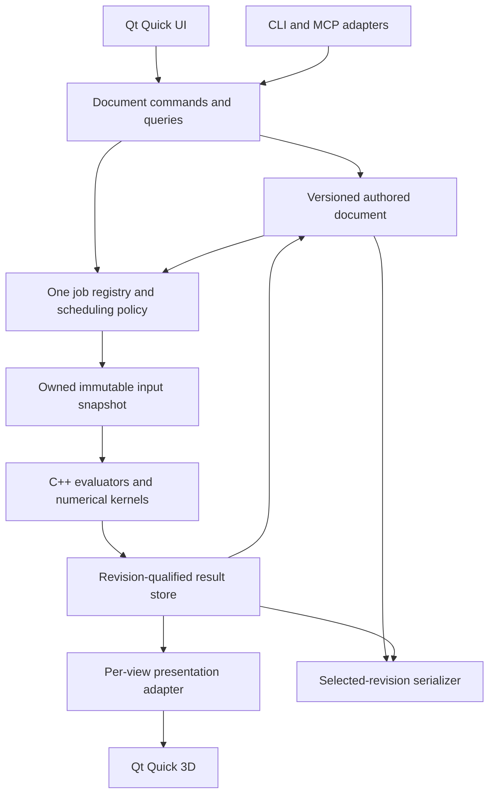

# AnthroForge standalone: technology stack analysis

Date: 2026-10-16. Status: evidence-based recommendation for implementation, not a completed standalone application or a benchmark result.

Subsequent development preparation has now installed the runtime/SDK, built the native boundary and Qt geometry plugin, and rendered a small desktop fixture. See [development readiness](<E:/development/anthroforge/docs/development_status.md>) for observed checks and the pytetwild/SDK integration findings. The analysis below retains its original evidence scope; production-scale viewport and anatomical migration claims remain unvalidated.

The [confirmed specification](<E:/development/anthroforge/standalone_application_recommendations.md#1-product-direction-and-scope>) governs this analysis. Its product decisions are settled; recommendations below do not silently change them. The interview is complete. Primitive examples and feature-specific implementation details remain deliberately deferred.

## 1. Recommended stack

**Use Qt 6 with PySide6 and QML for the desktop application, the existing C++17 numerical libraries for geometry and optimization, and a renderer-independent Python application core for document operations, scheduling policy, persistence, and automation. Use Qt Quick 3D as the first viewport implementation, with a small C++ geometry bridge and native precise picking.**

This preserves substantial useful code while removing Blender from normal operation. The largest work is the owned document and evaluation pipeline, Blender-dependent primitive evaluation, and geometry publication. Replacing Python or adopting a game engine would not remove that work.

Qt Quick 3D is a qualified recommendation: it supplies useful rendering infrastructure, but its performance on AnthroForge's changing, transparent anatomical scenes is untested. Keep its boundary narrow enough to replace it without rewriting anatomy, jobs, saving, or automation. Section 12 defines the experiment that can confirm or reject this choice.

| Component | Recommended starting point | Reason and qualification |
| --- | --- | --- |
| Desktop UI | Qt Quick/QML, PySide6; one main QQuickWindow | Shared desktop controls and a coherent interface around a 3D workspace. Avoid a mixed Widgets/Quick host unless a concrete need justifies it. |
| Viewport | Qt Quick 3D; C++ QQuick3DGeometry provider | Integrates with QML and supports supplied geometry. Picking, result lifetime, and publication policy remain application responsibilities. |
| Native engine | Existing C++17 kernels, Eigen, PIQP, libigl, current native query structures | Preserve algorithms and numerical safeguards. Add primitive evaluators, owned geometry, and missing optimization ports here. |
| Shared application core | Typed Python modules without bpy, QML, or viewport dependencies | Reuse existing application/authoring contracts. Own commands, document relationships, job policy, history, and persistence orchestration. Large numeric payloads are native handles/arrays, not Python object graphs. |
| Runtime candidate | CPython 3.12, Qt/PySide6 6.12.0 | Public package metadata currently supports this combination's individual dependencies. A complete installation/build test is still required. |
| Python numerical dependencies | Initially NumPy 1.26.4, SciPy 1.15.3, scikit-image 0.25.2; retain current remeshing/tetrahedralization versions | Separate host migration from algorithm/dependency upgrades. Iterative optimization still moves to C++; a NumPy call inside a Python optimization loop does not satisfy the native rule. |
| Native boundary | Preserve the C ABI/ctypes interfaces; add explicit owned buffer handles | Existing kernels already load independently. Do not require a wholesale binding rewrite. The C++ viewport bridge shares the same engine allocation/lifetime contract. |
| Build | Existing Windows clang-cl/MSVC ABI infrastructure, incrementally expressed through CMake/Ninja targets | Retain working flags, dependencies, and tests. Use a Qt SDK compatible with the packaged PySide runtime and one reproducible compiler/runtime configuration. |
| Project storage | Proposed versioned manifest plus typed binary assets in a self-contained package | Fits one writer, explicit snapshots, no persisted undo, and existing content-addressed storage ideas. Container choice is still an implementation decision. |
| Automation | Same Python command API, standalone CLI, optional thin MCP adapter | UI and AI share behavior; headless computation does not initialize Qt rendering. |
| Distribution | Pinned bundled runtime; first evaluate pyside6-deploy/Nuitka in directory mode | Users should not install Python, Blender, a compiler, or pip dependencies. Validate QML plugins and all native runtime dependencies in the package. |

The currently published PySide6 package is 6.12.0 and accepts Python 3.10–3.15. Registry inspection found Windows Python 3.12-compatible wheels for the retained NumPy/SciPy/scikit-image versions, pyinstantmeshes 1.0.0, and pytetwild 0.4.2. This establishes availability, not a tested combined environment. [PySide6](https://pypi.org/project/PySide6/), [NumPy 1.26.4](https://pypi.org/project/numpy/1.26.4/), [SciPy 1.15.3](https://pypi.org/project/scipy/1.15.3/), [scikit-image 0.25.2](https://pypi.org/project/scikit-image/0.25.2/), [pyinstantmeshes](https://pypi.org/project/pyinstantmeshes/1.0.0/), [pytetwild](https://pypi.org/project/pytetwild/0.4.2/).

## 2. What was actually established

This analysis inspected the current addon working tree, native exports/build scripts, authoring boundaries, job orchestration, startup callbacks, persistence, and skin/topology dependencies. HEAD was ce5012f993662f5416973a84ce0157500150a3a2, with 22 local status entries. Findings describe that working tree, including local changes; they are not a reproducible clean-HEAD audit. No local source changes were discarded and no Git remote was contacted.

The static inventory below excludes vendored/build native trees. Direct Blender imports mean imports of bpy, bmesh, or mathutils; transitive dependencies are not counted. These counts indicate the breadth of migration, not percentages of portable code.

| Area | Python files | Lines | Files with direct Blender imports |
| --- | ---: | ---: | ---: |
| core | 545 | 72,815 | 95 |
| app | 119 | 11,904 | 26 |
| adapters | 109 | 12,237 | 48 |
| operators | 33 | 3,705 | 33 |
| properties | 8 | 1,147 | 8 |
| ui | 39 | 3,223 | 26 |

The inspected native source inventory contains 101 C++ source/header files and 9,236 lines outside vendor/build trees. In particular, a directory named core is not already a Blender-independent standalone core.

A bounded executable probe used the installed Python 3.10.6 interpreter, outside Blender, to load the existing fiber and deformation DLLs and query metadata. The fiber library reported ABI 3, capability mask 1073741823, and four workers; deformation reported ABI 1. **This confirms that these native libraries can load without Blender on this machine. It does not validate numerical output, concurrent use, or deployment on another machine.** PySide6 was not installed in that interpreter; no Qt viewport was run. The proposed Python 3.12 environment was not installed or benchmarked.

Historical evidence remains useful but was not rerun:

- The [native muscle pipeline record](<C:/Users/alexe/AppData/Roaming/Blender Foundation/Blender/5.0/scripts/addons/anthroforge/docs/muscle_native_numeric_pipeline_2026-09-04.md>) records roughly 0.91 ms numerical computation and 68.01 ms mesh publication in one production comparison.
- The [interaction audit](<C:/Users/alexe/AppData/Roaming/Blender Foundation/Blender/5.0/scripts/addons/anthroforge/docs/interaction_ux.md:37>) records a 310.91 ms setter with zero fiber solves, and subsequent batching improvements with matching captured geometry hashes.
- The [attachment propagation experiment](<C:/Users/alexe/AppData/Roaming/Blender Foundation/Blender/5.0/scripts/addons/anthroforge/docs/attachment_propagation_experiments_2026-09-03.md>) records incorrect results when real dependency barriers were removed.

Together, these support investigating preparation, batching, ownership, and publication. They do not demonstrate that Qt will be faster, that all pauses originate in Blender, or that evaluation barriers can be removed safely.

## 3. Specification implications

| Confirmed behavior / requirement group | Consequence for architecture |
| --- | --- |
| A: stable anatomical identities, one SCP root, partial documents, independent imported copies | A persistent semantic document owns IDs, references, units, and hierarchy. A renderer scene graph cannot be the document. Import remaps identities and attaches the copied root atomically. |
| A/D/E: attachments, shared fiber branches, muscles, tissues, mirrors | Keep authored intent, support geometry, evaluated results, and display geometry distinct. Primitive correspondence is an engine contract, not a triangle-index assumption. Preserve each migrated feature's constraints and diagnostics. |
| B: foreground editing while work runs | Prepare owned inputs and numeric outputs away from the UI. Coordinate existing workers and their native thread counts through one policy. Background solve alone is insufficient. |
| B/C: per-object writers, obsolete work, queued requests, undo/redo | Central job registry, input revisions captured at execution, explicit output reservations, cooperative cancellation, and publication eligibility checks. |
| C/H: historical save checkpoint while other calculations run | Retain immutable historical document/result references. A database transaction or the most recent globally idle state is not automatically the user's checkpoint rule. |
| F: transparent outside context, deeper selection, curves, per-view presentation | Renderer-independent precise picking, category filters, per-view styles, and native color preservation. Focus changes presentation/editability without deleting computation dependencies. |
| G/H: same capability through UI and AI | Commands and queries belong to shared services. Screenshots and numeric diagnostics carry the same geometry revision. UI selection/context is not an implicit input. |
| H: skin-with-topology-only export, new projects first | Preserve canonical polygon topology separately from render triangles. Finish the skin/topology path before claiming a usable exported first release. Editable legacy conversion is separate. |
| H: addon-equivalent automatic load work only | Explicit startup policy based on actual callbacks. Do not run every stale computation just because a new scheduler can do so. |
| I: soft responsiveness goals, Windows first, future portability | Instrument full latency and memory; choose bounded workloads empirically. Keep native exports, filesystem/process adapters, and rendering backend assumptions isolated. |

## 4. What to reuse and what to replace

### 4.1 Keep native kernels and strengthen ownership

The current production collision bridge selects af_fiber_ccd_v3_57.dll with ABI/capability checks in [collision_native.py](<C:/Users/alexe/AppData/Roaming/Blender Foundation/Blender/5.0/scripts/addons/anthroforge/core/vcp/v2/collision_native.py:85>). An older unversioned wrapper also exists; it should not be mistaken for the current production default.

The engine already contains owned triangle snapshots/BVH queries, SQP work, asynchronous coordinators, cancellation state, muscle batches, skin numerical work, and smoothing. See [native exports and TriangleSnapshot](<C:/Users/alexe/AppData/Roaming/Blender Foundation/Blender/5.0/scripts/addons/anthroforge/native/fiber_ccd/af_fiber_ccd.cpp:23>), [SQP coordinator](<C:/Users/alexe/AppData/Roaming/Blender Foundation/Blender/5.0/scripts/addons/anthroforge/native/fiber_ccd/af_fiber_v3_native_sqp.hpp:728>), and [muscle batching](<C:/Users/alexe/AppData/Roaming/Blender Foundation/Blender/5.0/scripts/addons/anthroforge/core/vcp/muscle_numeric_native.py:36>).

Reuse these capabilities. Extend them with explicit document/job ownership, immutable geometry handles, safe snapshot lifetimes, and coordinated resource budgets. Existing asynchronous code is a starting point, not proof of concurrent multi-document safety: global caches, coordinator maps, and process-global thread settings need audit. Low-level resumability does not imply that persistent paused calculations or resume-on-redo belong in version one.

The [fiber build](<C:/Users/alexe/AppData/Roaming/Blender Foundation/Blender/5.0/scripts/addons/anthroforge/native/fiber_ccd/build_windows.ps1>) already uses C++17, clang-cl, the MSVC runtime, OpenMP, Eigen, and staged DLL replacement. [Smoothing](<C:/Users/alexe/AppData/Roaming/Blender Foundation/Blender/5.0/scripts/addons/anthroforge/native/smoothing/CMakeLists.txt>) already has CMake/CTest targets. [Deformation](<C:/Users/alexe/AppData/Roaming/Blender Foundation/Blender/5.0/scripts/addons/anthroforge/native/deformation/native.cpp>) already uses Eigen/libigl behind a C interface. Incorporate these targets incrementally rather than introduce an unrelated engine/toolchain.

### 4.2 Reuse application contracts, not Blender objects

[Authoring models and ports](<C:/Users/alexe/AppData/Roaming/Blender Foundation/Blender/5.0/scripts/addons/anthroforge/core/authoring/model.py:17>) already distinguish snapshots and interfaces. [Authoring services](<C:/Users/alexe/AppData/Roaming/Blender Foundation/Blender/5.0/scripts/addons/anthroforge/app/authoring/service.py>) inject inventory, identity, and publication capabilities. [DraftRepository](<C:/Users/alexe/AppData/Roaming/Blender Foundation/Blender/5.0/scripts/addons/anthroforge/core/authoring/repository.py>) provides revision checking and receipts; [storage](<C:/Users/alexe/AppData/Roaming/Blender Foundation/Blender/5.0/scripts/addons/anthroforge/core/authoring/storage.py>) provides atomic JSON/content-addressed assets.

Carry these contracts and useful implementations forward. They are not yet a complete editable project schema, historical checkpoint store, or whole-document undo implementation. In particular, copying a draft dictionary is not a viable strategy for retaining many full production meshes.

The [runtime contract](<C:/Users/alexe/AppData/Roaming/Blender Foundation/Blender/5.0/scripts/addons/anthroforge/docs/runtime_contract.md>) already specifies dirty aspects, interactive/final intent, coalescing, bounded passes, and invalidation. [job_revision.py](<C:/Users/alexe/AppData/Roaming/Blender Foundation/Blender/5.0/scripts/addons/anthroforge/adapters/job_revision.py>) already rejects stale results. The proposed change is a single document-owned policy and broader consistent coverage, not the invention of revision guards or asynchronous processing.

### 4.3 Replace capture, publication, and host-specific primitive evaluation

[Authoring capture](<C:/Users/alexe/AppData/Roaming/Blender Foundation/Blender/5.0/scripts/addons/anthroforge/adapters/authoring/capture.py:12>) requires the main thread, updates Blender evaluation, and converts evaluated meshes into arrays. [Topology publication](<C:/Users/alexe/AppData/Roaming/Blender Foundation/Blender/5.0/scripts/addons/anthroforge/adapters/topology/output.py:24>) converts arrays into lists and Blender mesh data. These are concrete boundaries to replace with owned data and a buffer-oriented viewport adapter.

The first primitive family currently depends on Geometry Nodes construction in [action_library_curve_loft.py](<C:/Users/alexe/AppData/Roaming/Blender Foundation/Blender/5.0/scripts/addons/anthroforge/core/action_library_curve_loft.py>). Connected pieces depend on curve modifiers and hooks in [action_library_split_corner.py](<C:/Users/alexe/AppData/Roaming/Blender Foundation/Blender/5.0/scripts/addons/anthroforge/core/action_library_split_corner.py>) and [SCP surface extraction](<C:/Users/alexe/AppData/Roaming/Blender Foundation/Blender/5.0/scripts/addons/anthroforge/core/scp_runtime/surface.py:88>).

Those behaviors need native evaluators with parity fixtures. A Qt cube primitive cannot substitute for their modifier semantics. User examples must establish curve parameterization, frames/twist, joins, caps, profile behavior, and attachment correspondence. Examine the relevant Blender implementation when specifying each evaluator; this analysis did not audit Blender's C++ kernels for direct extraction. Start with the required operations, rather than transplanting Blender's entire dependency graph or modifier stack.

Subsequent confirmed feature work: the [0.1.2 primitive/deformer specification](docs/primitives_012.md) now records the user's reference scenes, node-graph and Hook/Lattice source inspection, construction/deformation separation, connected loft seams, topology locks, and permanent exclusion of Apply/Bake. It supersedes the open product choices in this paragraph. Native extraction, integration, and standalone parity remain implementation work; the earlier analysis's inspection limits are historical.

### 4.4 Port the full skin/topology pipeline deliberately

[Draft skin solving](<C:/Users/alexe/AppData/Roaming/Blender Foundation/Blender/5.0/scripts/addons/anthroforge/core/draft_skin/solver.py>) already has substantial host-independent NumPy/SciPy/scikit-image logic and native numerical stages. The [topology engine directory](<C:/Users/alexe/AppData/Roaming/Blender Foundation/Blender/5.0/scripts/addons/anthroforge/adapters/topology/engine>) contains reusable array algorithms despite its adapter location. Classify by actual dependencies, not directory name.

Current [draft skin jobs](<C:/Users/alexe/AppData/Roaming/Blender Foundation/Blender/5.0/scripts/addons/anthroforge/adapters/draft_skin/jobs.py:37>) and [topology jobs](<C:/Users/alexe/AppData/Roaming/Blender Foundation/Blender/5.0/scripts/addons/anthroforge/adapters/topology/jobs.py>) create Blender snapshot files and launch background Blender processes. Replace their input/process boundary with document snapshots and a standalone worker entry point. Preserve numerical and output validation behavior.

There is also numerical work still requiring native migration. For example, [constrained_arap](<C:/Users/alexe/AppData/Roaming/Blender Foundation/Blender/5.0/scripts/addons/anthroforge/core/warm_start/arap.py:11>) contains the optimization iteration in Python. Keeping SciPy solves inside that loop would violate the native optimization rule for migrated work. Move the complete retained iteration/objective/constraint work into C++. Existing native deformation is a useful dependency, but equivalence of its constraints to this warm-start algorithm has not been established.

### 4.5 Change document semantics explicitly

The addon permits several parentless SCPs under an AF_ROOT container; the new specification permits exactly one SCP root. Existing import assigns new IDs but can leave imported roots parentless. The standalone import must attach the copied root to a chosen parent, preserve internal relations, and normalize units. These are deliberate product changes, not simple serializer substitutions. See [tree handling](<C:/Users/alexe/AppData/Roaming/Blender Foundation/Blender/5.0/scripts/addons/anthroforge/core/scp_runtime/tree.py>), [parenting](<C:/Users/alexe/AppData/Roaming/Blender Foundation/Blender/5.0/scripts/addons/anthroforge/app/use_cases/scp_parenting.py>), and [import service](<C:/Users/alexe/AppData/Roaming/Blender Foundation/Blender/5.0/scripts/addons/anthroforge/core/importing/service.py>).

Keep an empty grouping SCP distinct from a surface-bearing SCP: a grouping root cannot satisfy a surface attachment by proximity. Preserve explicit missing-reference states and require a valid attachment domain for dependent operations.

## 5. Alternative stacks

These comparisons are engineering judgments based on the current code and documented APIs, not comparative benchmarks.

| Candidate | Useful fit | Additional work or material risk | Decision |
| --- | --- | --- | --- |
| Qt Quick/QML + Quick 3D + Python/C++ | Reuses Python services and C++ kernels; integrated desktop/viewport UI; flexible custom presentation | Native precise picking and buffer bridge required; large updates and dense transparency need testing | Recommended first implementation |
| Qt Widgets + VTK + Python/C++ | Scientific mesh visualization, established rendering/query facilities, conventional desktop panels | Additional substantial toolkit and data representations; custom anatomy interaction still needed; validate dynamic updates and transparency | Strong alternative if the viewport trial favors it; no claim that it is slower or faster |
| Qt + application entirely in C++ | Uniform native ownership and no Python GIL in services | Rewrites significant existing orchestration, schemas, and authoring logic; does not solve GPU publication by itself | Keep as a response to measured service bottlenecks, not a prerequisite |
| Godot + C++ GDExtension | Integrated renderer, scene tools, C++ extension mechanism | Most Python services require porting or a separate process; engine scene tree must remain separate from document truth; editing/scheduling still custom | Viable, but higher migration work for this repository |
| Electron or Tauri + web 3D + native worker | Web UI ecosystem; native engine can remain separate | Binary geometry transfer/lifetimes across another runtime, desktop packaging, viewport interaction, and Python integration add boundaries | Consider if web delivery becomes a product objective; it is not one now |
| Rust + wgpu + native engine | Explicit ownership and control of rendering | Another implementation language/FFI boundary and substantial editor/rendering infrastructure to build | No demonstrated current benefit sufficient to justify it |
| Blender fork/custom startup | Maximum reuse of Blender geometry and viewport | Retains Blender host/data/context architecture and conflicts with the user's own-framework decision | Outside the selected product scope |

VTK provides a native Qt OpenGL widget integration and depth-peeling facilities, although support and effectiveness depend on renderer configuration. These justify a concrete alternative test, not an assumption that scientific software automatically handles this scene well. [QVTKOpenGLNativeWidget](https://vtk.org/doc/nightly/release/9.4/html/classQVTKOpenGLNativeWidget.html), [vtkRenderer](https://vtk.org/doc/nightly/html/classvtkRenderer.html).

Godot's GDExtension supports native libraries, but active scene/resource access has threading constraints. Its standard headless rendering server disables rendering, so computational headless operation and GPU image inspection would still need different modes. [GDExtension configuration](https://docs.godotengine.org/en/stable/engine_details/engine_api/gdextension/gdextension_file.html), [thread safety](https://docs.godotengine.org/en/stable/tutorials/performance/thread_safe_apis.html), [RenderingServer](https://docs.godotengine.org/en/stable/classes/class_renderingserver.html).

Tauri can package native sidecars and Electron offers utility processes; neither requires abandoning C++. Their extra process/runtime boundary is the migration tradeoff here. wgpu is a portable graphics API, not a ready anatomical editor. [Tauri sidecars](https://v2.tauri.app/develop/sidecar/), [Electron utility processes](https://www.electronjs.org/docs/latest/api/utility-process), [wgpu](https://wgpu.rs/doc/wgpu/index.html).

Do not add OpenCascade, a new general-purpose geometry framework, OpenVDB, or mandatory CUDA solely because the application is standalone. The first primitives are curve-driven, the current skin pipeline already exists, and native queries already exist. Add a dependency only when a named missing operation and a representative test justify it.

## 6. Ownership, jobs, and revision architecture

### 6.1 Dependency direction

The shared core includes Python application services and a C++ engine; it does not require all domain records to be C++ classes. Neither part imports the desktop UI. Qt objects are presentation adapters. Numerical workers receive owned input snapshots, not access to mutable Python dictionaries, Blender objects, or Qt scene objects.

Keep canonical precision and units at the engine boundary. Preserve existing double-precision computations where required; convert separate render buffers as appropriate. Display scaling or reduced detail must not change support/collision accuracy. Cache keys include relevant entity/input revisions and algorithm/settings versions.

### 6.2 One policy over existing execution facilities

Maintain one registry covering queued, preparing, running, publishing, cancellation-pending, and terminal jobs. It owns output reservations, priorities, dependency reasons, progress, failure information, and save-blocking status. Existing native coordinators or worker processes can remain execution facilities beneath that registry; they must not independently decide document commitment.

At dispatch, reserve the complete output set and capture input versions atomically relative to edits. Coalesce replaceable automatic requests; preserve distinct explicit commands. Edits can invalidate a worker's snapshot without blocking the editor. Check eligibility again before accepting output, including after undo, import, deletion, and document replacement. Register real dependent work before parent completion.

Use native worker threads for established safe native kernels. Isolated worker processes remain useful for third-party tools or substantial noninteractive preparation with awkward library state. Give both forms identical job semantics. A Python thread is not sufficient evidence that CPU-heavy Python preparation is responsive. ctypes CDLL calls release the GIL during native execution, but that does not make a synchronous UI call asynchronous, make shared buffers safe, or release the GIL during Python preparation. [Python ctypes](https://docs.python.org/3/library/ctypes.html).

The current bridge defaults to four native workers and configures a process-global setting. Several simultaneous OpenMP/native pools can oversubscribe the CPU. Coordinate job concurrency, per-kernel worker budgets, memory estimates, and interactive priority. Do not retune a global thread setting concurrently without checking its implementation. Retain Eigen's existing internal-parallelism controls. The 24-thread reference machine is a test environment, not a rule to launch 24 simultaneous calculations.

Cancellation acknowledgement and actual safe termination are separate measurements. A superseded writer still holds its output reservation until safely terminal. One pending replacement can then acquire fresh inputs. Read-only diagnostics do not block commitment; a diagnostic that writes persistent document state is a write job.

### 6.3 Retained versions and the exact save rule

Use immutable revision records with shared immutable geometry/assets and explicit pins from history, running jobs, views, and saves. Changes replace affected records/buffers; they do not deep-copy the full document on every drag update. Release old buffers only after all consumers finish. Bound transient preview retention without dropping a checkpoint needed by an active job or save.

The eligible save checkpoint is the version before the earliest still-running writer started. It can advance while another writer remains running. A queued-only interval retains the previous eligible checkpoint. Once all writes are terminal, the current state can commit even if some failed. Preserve this rule directly; do not substitute a batch-wide initial checkpoint or require global numerical success.

Historical state may include old/stale completed output and recorded failures. Save its own geometry/freshness metadata; never graft today's displayed preview onto yesterday's document. Live provisional output is presentation data, not automatically a completed result suitable for export or downstream attachment support.

Saving a frozen chosen revision should be classified as a read of the document, even though it writes bytes to disk; otherwise the save job would block itself under the document-write rule. Opening/importing or publishing a result does mutate document state. Keep this distinction explicit in the job API.

The modal Wait and Save path freezes new UI edits, drains queued and active writers including their real dependent jobs, and saves automatically when terminal. Cancelling the wait resumes editing without cancelling calculations. Headless saving requires an explicit blocked-save policy and returns a structured result. Undo cancellation is tied to the starting revision; redo resubmits rather than restoring an old worker. No worker threads, undo stacks, or paused continuations are persisted in version one.

## 7. Viewport architecture and limits

### 7.1 Geometry publication

Build geometry, normals, bounds, and numeric validation outputs outside the UI. Pass stable handles plus small revision metadata through application services. A C++ Qt adapter exposes geometry without constructing one Python object per vertex or repeatedly converting arrays to lists. This is a design objective, not a claim of zero-copy transfer all the way to the GPU.

Qt Quick 3D supports custom geometry, but partial updates are not guaranteed to produce partial GPU updates. The implementation may replace the entire graphics resource. Consequently, measure upload stalls and choose object/chunk sizes empirically. Prepare complete replacement buffers asynchronously, retain the last accepted display, and swap only eligible bundles. [QQuick3DGeometry](https://doc.qt.io/qt-6/qquick3dgeometry.html).

An illustrative size calculation: one million vertices with float32 positions/normals and two million triangles with uint32 indices require about 48 MB before attributes, native double-precision input, acceleration structures, snapshots, or GPU staging. Fifty full copies would already consume about 2.4 GB for that payload alone. These are arithmetic examples, not measured AnthroForge scene sizes. Structural sharing and measured publication granularity are therefore essential even on the reference PC.

Use a QQuickWindow/QML shell. Embedding the main viewport through QQuickWidget adds an offscreen pass and disables the threaded render loop according to Qt's documentation. There may be reasons to use it in another design, but it is a poor default for this responsiveness objective. [QQuickWidget limitations](https://doc.qt.io/qt-6.11/qquickwidget.html).

### 7.2 Selection is an application feature

Qt documents bounding-volume-only picking for models using custom geometry. It cannot directly satisfy narrow fibers, overlapping muscles, or deliberate deeper selection. Implement precise picking in the native query layer and reuse eligible spatial data where appropriate. [Model picking](https://doc.qt.io/qt-6/qml-qtquick3d-model.html#picking).

Define candidate generation and ordering separately: surface intersections, screen-space curve/handle distance, category filters, hidden/unpickable context, and deeper cycling. Hover and click use the same policy and geometry revision. A curve needs its own hit representation; it should not disappear from selection because its tube tessellation is coarse. Refit/rebuild picking structures only when relevant geometry changes, not on every mouse movement. Preserve entity and surface-role IDs through batching/instancing.

### 7.3 Transparency and inspection

Qt 6.11 introduced weighted blended and linked-list order-independent transparency. The first is approximate; the second sorts fragments for accurate blending. OIT is off by default and has blend-mode/backend restrictions. This is a useful current capability: an analysis based only on older Qt transparency limitations would miss it. Dense overlapping anatomy still needs measured visual and memory tests. [SceneEnvironment OIT](https://doc.qt.io/qt-6/qml-qtquick3d-sceneenvironment.html#oitMethod-prop).

Implement per-view default/hover/selection styles, native SCP colors, and very transparent read-only outside-workspace context. Show selection outlines, local clipping/cutaways, and task-specific visibility where they improve interpretation; opacity alone cannot resolve all overlap. Style changes should update presentation, not enqueue anatomy evaluations. Preserve authored appearance and named workspace settings while excluding temporary hover state from saved appearance.

### 7.4 Offscreen rendering and fallback boundary

Qt Quick 3D supports multiple graphics backends; Windows defaults to Direct3D 11. Its 3D renderer does not work with Qt Quick's software adaptation. Start with the default backend on the RTX 4080 and record the exact backend/driver in evidence; compare another backend only for a concrete issue. [Qt Quick 3D requirements](https://doc.qt.io/qt-6/qtquick3d-requirements.html).

Pure computation must run without a renderer. Image inspection can use a separate Qt render entry point based on QQuickRenderControl, initialized only when requested. Match camera, presentation, and geometry revision to numerical queries. Verify windowless GPU execution on the packaged Windows application; an API's existence is not a successful deployment test. [QQuickRenderControl](https://doc.qt.io/qt-6/qquickrendercontrol.html).

If the representative trial exposes a renderer limitation, first determine whether it lies in the engine, handoff, upload, or draw stage. Compare Qt Widgets/VTK on the same payload if needed. A custom QQuickRhiItem renderer is a more costly option when exact buffer/render control is essential: its underlying QRhi interfaces have limited compatibility guarantees and may require Qt private development interfaces. Do not make this the initial maintenance burden. [QQuickRhiItem](https://doc.qt.io/qt-6/qquickrhiitem.html).

## 8. Persistence, import, export, and headless API

A proposed first container is ZIP64 with a versioned JSON manifest and hashed typed binary geometry/assets. The manifest records canonical units, entity identities, relationships, primitive definitions, algorithm/result revisions, freshness/failure states, provenance, and named workspaces. Store the selected checkpoint's completed results and necessary embedded input geometry. Keep acceleration caches explicitly disposable. Avoid executable/pickle payloads.

This proposal extends the existing storage approach and fits a single writer with no persistent undo history. It is not a final format decision. Large compressed arrays require decompression; measure open/save latency and peak memory. Use stored/uncompressed entries or another layout where appropriate. SQLite is a credible alternative if measured partial access or incremental updates justify it; it does not remove the need to define the application's revision/checkpoint semantics.

Write a new file beside the destination, finish and validate it, then replace the old file. Preserve the old file on ordinary write failure, and enforce the one-writer contract. Safe replacement and schema migration design are normal save correctness; they do not imply a completed crash-recovery/autosave system. Do not persist the full in-session history merely to make saving convenient.

Imported documents become independent content with fresh IDs and source provenance. Importing raw meshes preserves geometry and TRS only in version one. Explicitly convert units, resolve the root attachment, and surface missing external references. Blender conversion remains an optional separate tool and is not a startup/runtime dependency.

Keep polygon face connectivity, including quads, as canonical topology. Derive triangles for display and collision. Export only a built, revision-qualified skin with topology. Internal temporary OBJ output used by the remesher is not already a user-facing exporter. OBJ is a reasonable format candidate to evaluate with the user's downstream tool; the concrete format remains deferred. glTF's triangle-based surface primitives cannot directly preserve a quad face structure, so selecting glTF by habit would lose that property. [glTF primitive modes](https://registry.khronos.org/glTF/specs/2.0/glTF-2.0.html).

The application API should expose explicit commands, transactions, entity/revision queries, job inspection/cancellation, project load/save, and permitted export. UI interactions, scripts, tests, and AI call the same implementations. Start with a Python API and CLI; add MCP as a protocol adapter. Local stdio is an established MCP transport and avoids requiring a network service for an offline application. Pin an interoperable protocol/SDK version during implementation rather than exposing internal engine calls as a protocol. [MCP transports](https://modelcontextprotocol.io/specification/2025-11-25/basic/transports).

Headless sessions own their documents independently. Commands return revision/job IDs and structured errors. Image requests identify the same revision as numeric inspection. Saving with unfinished writers requires the caller's explicit policy; it must not silently choose waiting or overwrite a live UI session's file.

## 9. Startup parity

The user requested addon-equivalent automatic opening behavior, not automatic completion of all stale work. Static inspection found the following migration inventory:

| Current load behavior | Standalone interpretation |
| --- | --- |
| load_pre clears/cancels old runtime work; load_post hydrates and synchronizes | Start a fresh session with clean job ownership; hydrate saved document/workspace state. Do not resurrect the previous process's jobs. |
| Shared-point migration, defaults, control/selection hydration, cache invalidation | Apply schema migration and rebuild needed runtime indexes; discard stale caches. Separate required data migration from optional numerical recomputation. |
| SCP parent attachment synchronization and mirrors | Preserve their applicable opening behavior for supported entities. |
| Fiber LOAD handling restores paths/bindings/handles and can capture missing attachments | Preserve this work; LOAD bypasses route/refinement solving but is not a blanket geometry-free pass. |
| Fiber surfaces, muscles/inflation, blobs, and supported soft tissue synchronize | These are candidates for actual automatic opening jobs. Preserve legacy upgrade-required states rather than silently upgrading/rebuilding everything. |
| Muscle pair/stack processing follows saved automatic settings | Preserve saved automatic/manual distinctions and stale status. |
| Anchor warnings and mesh diagnostic state are refreshed/marked stale | Keep diagnostics distinct from repairs; persistent diagnostic writes follow the job policy. |
| No direct unconditional draft-skin/topology build or full transfer fit on opening | Do not add them automatically. Indirect effects of startup geometry changes still require fixture observation. |

Relevant code: [control runtime load hydration](<C:/Users/alexe/AppData/Roaming/Blender Foundation/Blender/5.0/scripts/addons/anthroforge/core/visualization/control_runtime.py>), [built-in synchronization drivers](<C:/Users/alexe/AppData/Roaming/Blender Foundation/Blender/5.0/scripts/addons/anthroforge/core/deps/builtin_drivers.py>), and [muscle-pair runtime](<C:/Users/alexe/AppData/Roaming/Blender Foundation/Blender/5.0/scripts/addons/anthroforge/core/muscle_pairs/runtime.py>).

This inventory is based on callback/code inspection. A normal-open run on representative files is still required: timer/dependency effects can follow direct load callbacks. In particular, the deformation timer seeds its first observed revision, but later startup geometry changes may cause subsequent work. Do not claim such work is impossible from static inspection alone.

## 10. Packaging, portability, and licenses

The current numeric bundle is tied to Windows x64, CPython 3.11, NumPy 1.26.4, and Blender 5.0.1. The [draft-skin vendor loader](<C:/Users/alexe/AppData/Roaming/Blender Foundation/Blender/5.0/scripts/addons/anthroforge/adapters/draft_skin/vendor.py:33>) checks those assumptions; [topology packaging](<C:/Users/alexe/AppData/Roaming/Blender Foundation/Blender/5.0/scripts/addons/anthroforge/vendor/topology/manifest.json>) contains a cp311 Windows wheel. Copying these folders into a Python 3.12 application is not a valid packaging strategy.

Rebuild a hash-locked standalone dependency bundle for the selected interpreter, including transitive numerical dependencies, remeshing/tetrahedralization binaries, OpenMP/runtime DLLs, and the custom Qt plugin. Preserve initial algorithm versions and reference results. Do not combine migration with a NumPy-major upgrade unless a concrete dependency forces it and parity is re-established.

Keep ctypes where it already works. Match calling conventions, scalar/index widths, allocation ownership, errors, and capability versions explicitly. Never free memory in a different runtime from the allocator. Build the Qt C++ geometry plugin against the packaged Qt ABI with a compatible compiler. Use one core library instance per process so separate bindings do not accidentally create duplicate global engines.

The existing native code uses Windows-specific DLL names and __declspec exports. Wrap platform exports/loading/process paths, preserve position-independent builds where required, and keep renderer APIs out of numerical libraries. That provides a realistic route to Linux/macOS; it is not evidence those builds currently work. C++17 remains the kernel baseline; a particular future UI dependency can use a newer standard locally if required without rewriting kernels.

Qt's official pyside6-deploy uses Nuitka. Evaluate its standalone directory output first, including a clean-machine install/launch test, rather than optimize immediately for a one-file executable. Include CLI and optional offscreen rendering entry points from the same locked distribution. [pyside6-deploy](https://doc.qt.io/qtforpython-6/deployment/deployment-pyside6-deploy.html).

The user accepts open-source licensing. One relevant distinction is that Qt Quick 3D is offered under GPLv3 or a commercial license; do not assume every Qt module is LGPL. Plan distribution and source/license notices accordingly. [Qt licensing](https://doc.qt.io/qt-6/licensing.html), [Qt Quick 3D licensing](https://doc.qt.io/qt-6.12/qtquick3d-index.html).

Blender source reuse still needs a component/dependency review when an actual kernel is selected; accepting Blender's license does not identify a ready standalone library. Keep license/provenance records for Eigen, PIQP, libigl, numerical wheels, remeshing/tetrahedralization packages, and any extracted Blender code. This analysis is not a completed dependency license audit. [Blender licensing](https://www.blender.org/about/license/).

## 11. Migration order

1. **Establish the shared document and engine boundary.** Versioned IDs/units/hierarchy, native handles, a headless command entry point, one registry, per-object writer exclusion, stale-result rejection, historical checkpoint selection, and basic save/reopen. Exercise the user's overlapping-job and queued-job examples immediately.
2. **Run the representative viewport experiment.** Use captured production geometry as a developer fixture, not a promised legacy-project importer. Establish navigation, styles, precise picking, changing mesh publication, and offscreen revision consistency before building all panels around the renderer.
3. **Migrate a complete editable SCP/attachment path.** Use the user's concrete primitive examples, parent/child propagation, mirrors, empty grouping roots, import remapping, and transaction/undo behavior. Replace required modifier evaluation with qualified native functionality.
4. **Migrate fiber, muscle, tissue, and dependent workflows by feature.** Retain existing native algorithms, constraints, shared branches, diagnostics, and authoring operations. Replace Blender capture/publication and fold each execution path into the registry. Port remaining optimization loops when those features migrate.
5. **Complete skin, topology, deformation, and permitted export.** Package the numeric dependencies, replace background Blender workers, retain canonical topology, and verify a new project can reach usable skin export. Earlier milestones are useful development slices, not the complete first release.
6. **Finish startup parity, UI workflows, packaging, and production validation.** Apply the actual load policy, independent focused workspaces, activity/failure panels, headless save policies, and clean-machine verification. Record migration coverage and remaining feature work explicitly.

Keep an operation-level migration matrix: current command/feature, native dependencies, host dependencies, standalone entry point, authored/result schema, cancellation behavior, reference fixture, and parity evidence. Count a feature complete only when UI and headless behavior, persistence, and applicable geometry validation work together. General mesh editing, editable legacy conversion, persistent undo, paused-job recovery, and actual crash recovery do not expand this version-one scope.

## 12. Discriminating validation before broad UI investment

These are proposed implementation experiments, not results obtained in this analysis. They are designed to distinguish framework limitations from application mistakes and to avoid choosing a stack from a static demo.

| Experiment | Representative workload | Evidence needed / response to failure |
| --- | --- | --- |
| Native extraction and parity | Owned SCP/support arrays, fiber solving, muscle inflation, skin/topology/deformation fixtures | Compare geometry/constraints and errors against current reference outputs, not DLL load success. Fix ABI/input semantics before changing algorithms. |
| Preparation and publication isolation | Existing production anatomy, repeated edits, visible old output, incoming new meshes | Record prepare/validation/handoff/upload/draw separately. If Python/list conversion dominates, fix that boundary; if GPU upload dominates, test chunking/backend and then an alternate renderer. |
| Transparent inspection and picking | Dense muscles over SCPs and fibers; focused and whole-document views; native colors | Verify hover predicts click, category/deeper selection works, and transparency/cutaways remain readable. Compare OIT modes at declared resolution and memory use. |
| Scheduling and history | Two objects with overlapping jobs, queued replacement, multi-output writer, undo/redo, late result | Show no overlapping writers, dispatch-time snapshots, obsolete-result rejection, and cooperative cancellation. Exercise A0/A1 checkpoint movement and queued-only retention exactly. |
| Save and reopen | Wait/save-checkpoint/cancel, failed job, queued dependents, independent imported part, missing reference | Confirm the chosen revision is self-contained and coherent; no newest-preview mixing, false idle save, or unrequested startup rebuild. |
| Headless parity | Same commands and inputs through UI and CLI; optional image request | Match numeric/result revisions, failure semantics, and explicit blocked-save policy. Pure computation starts without GUI initialization. |
| Packaged runtime | Machine/environment without development Python, Blender, or compiler; offline launch | Resolve native/QML plugins and numerical wheels from the bundle. Exercise actual solving, saving, export, and optional offscreen images. |
| Memory and resource policy | Repeated edits and undo with long-running jobs; multiple independent native workloads | Track retained snapshots, CPU/GPU memory, worker budgets, and release after jobs/views finish. Do not trade a short smooth demo for unbounded retention. |

Use the reference PC recorded in the specification: Ryzen 9 7900X3D, 32 GiB RAM, RTX 4080, Windows 11 x64. Include existing production scenes such as the skull-muscle working data and representative skin/topology fixtures. Record file identity/revision, entity and vertex/face counts, visible layers, viewport dimensions, backend, driver, worker settings, and warm/cold cache state. Small synthetic scenes are useful diagnostics, not substitutes for those workloads.

Measure frame-time and input-latency distributions, worst stalls, picking cost, preparation, publication, cancellation acknowledgement, and actual safe stop. Approximately 30 FPS, 50 ms input response, and 100 ms cancellation acknowledgement remain soft goals, not newly imposed release thresholds. Judge extra optimization effort against the user's actual editing experience.

Keep Qt Quick 3D if the representative workflow is comfortable and its required custom work remains bounded. Reconsider it if repeatable upload stalls, selection integration, or transparency defects persist after the responsible stage is isolated and a bounded repair attempt is tested. Compare the exact failing workload in VTK or a narrower renderer experiment before proposing replacement. Do not restart the whole application architecture to repair a viewport boundary.

## 13. Decision and remaining uncertainty

The strongest supported direction is **Qt/PySide/QML + existing C++ kernels + a host-independent Python application core**, with **Qt Quick 3D behind a replaceable presentation boundary**. Reuse of the numerical engine and application contracts is supported by inspected code and the independent DLL load probe. Qt's suitability for the full interactive viewport remains an untested engineering hypothesis with explicit validation criteria.

The expensive work is now identifiable: native primitive evaluation, semantic document/history ownership, unified scheduling, bounded buffer publication, precise anatomical selection, and packaging/migrating the complete skin/topology pipeline. A switch to another UI framework would leave most of these tasks intact.

The first implementation decision should therefore be this stack plus a bounded representative viewport/document slice. Keep exact primitive behavior, attachment correspondence, file container, final export format, feature-specific job chains, and resource limits open until their concrete examples and measurements are available. No additional broad specification interview is required before that work.
